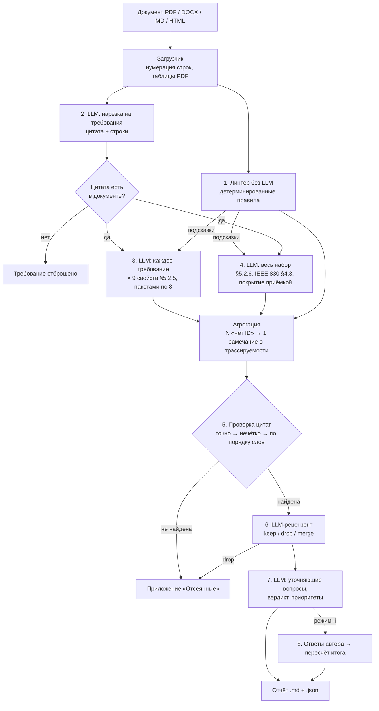

# Архитектура ReqGuard

## Задача

На вход подаётся документ требований (PDF, DOCX, MD, TXT, HTML). На выходе получается отчёт на русском языке,
в котором каждое замечание привязано к строке документа и к дословной цитате. Проверка идёт по
ISO/IEC/IEEE 29148:2018 (§5.2.5 — свойства требования, §5.2.6 — свойства набора) и IEEE 830-1998 (§4.3).

Главный риск LLM-агента в этой задаче — **выдуманные замечания**: модель «находит» дефект в тексте, которого
в документе нет. Второй риск — **шум**: десятки однотипных придирок, за которыми теряются настоящие проблемы.
Архитектура построена вокруг этих двух рисков.

## Конвейер

## Ключевые решения

### 1. Цитата проверяется кодом, а не доверием к модели

Модель обязана вернуть дословную цитату и номера строк. `document.locate()` ищет цитату в исходном тексте тремя
способами по очереди:

1. **Точное совпадение** после нормализации: регистр, `ё/е`, кавычки, тире, markdown-разметка, пробелы.
2. **Нечёткое совпадение** (≥ 85%) по окнам из 1–4 строк: модель могла чуть перефразировать.
3. **Совпадение по порядку слов**: слова цитаты идут в документе в том же порядке, но перемешаны
   с соседними колонками. Так выглядят таблицы, извлечённые из PDF.

Если цитата не нашлась, замечание не попадает в отчёт, а уходит в приложение «Отсеянные» с причиной.
Тот же фильтр применяется к нарезке: требование без привязки к тексту отбрасывается.

### 2. Гибрид: правила + LLM

Линтер (`rules.py`, `topics.py`) работает без модели и полностью воспроизводим. Он находит: размытые слова,
заглушки («заполняются тестировщиками»), незаполненные поля («—») и чек-листы («Да / Нет»), отсутствие версии,
смешение единиц (тиыны/тенге), изменение данных через `GET`, `Content-Type` без тела, неописанные HTTP-коды,
отсутствие приоритетов, а также откат, ИБ и мониторинг, упомянутые только в шаблоне чек-листа.

Находки линтера идут в промпт как **подсказки**: модель их проверяет. Затем они проходят тот же фильтр
цитат и рецензента, что и замечания модели.

### 3. Отдельный проход-рецензент

Рецензент видит все подтверждённые замечания и документ и решает по каждому: `keep`, `drop` или `merge`.
Правила, к которым мы пришли измерениями (см. таблицу ниже):

* `drop` — только если документ **прямо опровергает** замечание; при сомнении — `keep`;
* `merge` — только один и тот же дефект в одном месте; разные аспекты одного фрагмента остаются отдельными;
* критичный дефект с подтверждённой цитатой рецензент удалить не может, только понизить до существенного;
* при слиянии цитаты слитых замечаний сохраняются в строке «Тот же дефект проявляется: …».

### 4. Шум убирается детерминированно, а не запретами в промпте

Мы измерили, что правила «не дублируй», «не придирайся к атомарности» в промпте проверки требований
**снижают полноту** с 96% до 85%: модель вместе с дублями перестаёт писать настоящие замечания. Поэтому
шум убирается кодом: N замечаний «нет идентификатора» сводятся в одно о трассируемости, дубли с одинаковой
цитатой сливаются рецензентом с сохранением цитат.

### 5. Уточняющие вопросы как часть результата

Последний этап превращает подтверждённые дефекты в 8–15 вопросов автору: адресат (аналитик, бизнес, архитектор,
ИБ, QA), зачем вопрос, варианты ответа, предложение агента по умолчанию, связанные дефекты. В режиме `-i` агент
задаёт вопросы в терминале, а ответы закрывают дефекты и пересчитывают вердикт. Ответы сохраняются
в `*.answers.json` для воспроизводимого повтора (`--answers`).

### 6. Воспроизводимость и бесплатный тариф

* Ответ модели кэшируется по хэшу (модель, температура, промпт). Повторный прогон того же документа тем же
  кодом не тратит квоту и даёт тот же отчёт; паспорт помечает такой прогон как «воспроизведение из кэша».
* Прерванный прогон (лимит, сеть) при перезапуске доберёт только недостающие ответы.
* При поминутном лимите (429) — паузы 30–90 с; при дневном — немедленная остановка с понятным сообщением.
* Паспорт отчёта: SHA-256 документа, модель и температура, версия агента и коммит, число запросов и токенов.

## Измерения

`eval/golden.json` — экспертный эталон из 26 дефектов документа кейса (4 критичных, 17 существенных,
5 незначительных). Агент эталон не читает. `eval/score.py` считает эталонный дефект найденным, если хотя бы одно
итоговое замечание содержит его «якорную» цитату.

| Версия | Изменение | Полнота | Замечаний |
| :--- | :--- | :---: | :---: |
| v1.0.0 | первая версия | 92% | 39 |
| v1.1.0 | рецензент не удаляет критичные, сохраняет цитаты | 96% | 46 |
| v1.1.1 | правило «откат / ИБ / мониторинг» | 100% | 61–68 |
| v1.3.1 | запреты «против шума» в промпте | 85% | 29 |
| v1.3.2 | баланс: шум убирается кодом | **96%** | **51** |

Финальный прогон (v1.3.2, `gemini-3.6-flash`): 34 требования, 69 замечаний подтверждены цитатой (0 выдуманных),
рецензент оставил 51; найдены все 4 критичных и все 17 существенных дефектов эталона. Исходный прогон:
7 запросов к модели (+2 из кэша), ~48,6 тыс. входных и ~20,3 тыс. выходных токенов, 389 с.

## Модули

| Модуль | Назначение |
| :--- | :--- |
| `validator/document.py` | загрузка форматов, нумерация строк, поиск цитат |
| `validator/rules.py`, `topics.py` | детерминированный линтер |
| `validator/criteria.py` | свойства 29148 / 830 с источниками |
| `validator/prompts.py` | промпты этапов, все ответы строго JSON |
| `validator/llm.py` | Gemini, OpenAI-совместимые (OpenRouter, vLLM, Ollama), Anthropic; повторы, лимиты, кэш |
| `validator/pipeline.py` | конвейер, проверка цитат, рецензент, агрегация, уточнения |
| `validator/report.py` | отчёт Markdown |
| `validator/__main__.py` | CLI, режимы `-i` и `--answers` |
| `eval/` | эталон и оценка полноты |
| `tests/` | сквозной тест без сети (модель подменена сценарием) |

## Ограничения

* Таблицы PDF без рамок извлекаются с перемешанными колонками. Поиск по порядку слов защищает привязку цитат,
  а промпт запрещает модели считать это дефектом документа. Для таблиц с рамками используется `pdfplumber`.
* Сканы без текстового слоя не поддерживаются: агент сообщает об этом явно (OCR не входит в объём).
* Полнота измерена на одном документе кейса; эталон составлен экспертно и тоже может быть неполным.
